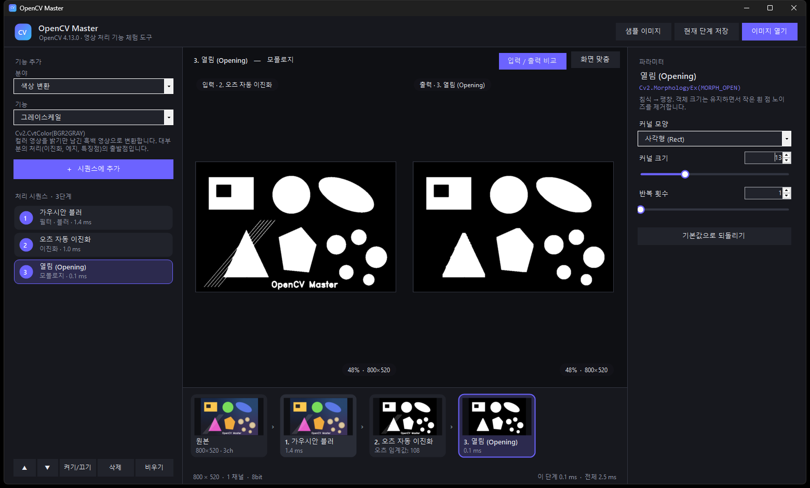

<p align="center">
  
</p>

<h1 align="center">OpenCV Master</h1>

<p align="center">코드를 작성하기 전에 OpenCV 기능을 미리 체험해 볼 수 있는 Windows 데스크톱 프로그램입니다.</p>

<p align="center">Author: <b>Manggdy</b></p>

<p align="center"><a href="README.md">English</a> | <b>한국어</b></p>



이미지를 불러와 처리 단계를 시퀀스로 엮고, 각 단계의 파라미터를 슬라이더로 조정하면서 모든 중간 결과가 실시간으로 바뀌는 것을 확인할 수 있습니다.

## 주요 기능

- **13개 분야, 88가지 OpenCV 기능**: 색상 변환, 필터·블러, 이진화, 모폴로지, 에지 검출, 기하 변환, 히스토그램, 특징점 검출(SIFT, ORB, AKAZE, BRISK, KAZE, FAST, MSER 등), 윤곽선·형태 분석, 영상 분할(워터셰드, 그랩컷, K-평균, SLIC), 노이즈·복원·주파수(DFT), 객체 검출(QR, HOG 보행자, 템플릿 매칭), 원본과 합성.
- **기능별 파라미터 UI 자동 구성**: 선택한 기능에 따라 슬라이더+숫자 입력, 드롭다운, 체크박스가 표시됩니다. 각 단계에는 호출하는 OpenCV API와 짧은 설명이 함께 나옵니다.
- **사용자 정의 처리 시퀀스**: 단계를 자유롭게 추가·삽입·순서 변경·켜기/끄기·삭제할 수 있습니다.
- **모든 단계 결과 미리보기**: 하단 필름 스트립에 단계별 결과가 표시되고, 뷰어에서 선택한 단계의 입력과 출력을 확대/이동이 동기화된 상태로 나란히 비교할 수 있습니다. 슬라이더를 움직이는 동안 백그라운드에서 다시 계산됩니다.
- **결과 정보**: 오츠 임계값, 윤곽선·특징점 개수, QR 해독 문자열 등을 보여줍니다.
- **다양한 이미지 형식**: OpenCV 디코더 → Windows Imaging Component(HEIC/HEIF, JXR, DDS, ICO 등) → GDI+(EMF/WMF) 순으로 시도합니다. 한글 경로를 지원하며 끌어다 놓기로도 열 수 있습니다.
- **픽셀 검사**: 이미지 위에 마우스를 올리면 좌표와 픽셀 값이 표시됩니다.

## 요구 사항

- Windows 10 1809 이상 (x64)
- .NET 10 SDK
- OpenCvSharp4 4.13.0 (OpenCV 4.13.0, contrib 모듈 포함), NuGet에서 자동 복원

## 사용법

1. 왼쪽에서 **분야**와 **기능**을 고르고 **＋ 시퀀스에 추가**를 누릅니다 (선택한 단계 바로 뒤에 삽입됩니다).
2. 단계를 선택하면 오른쪽 패널에서 파라미터를 조정할 수 있고, 결과가 즉시 갱신됩니다.
3. 하단 필름 스트립으로 모든 단계를 비교하고, **입력 / 출력 비교**를 켜면 나란히 볼 수 있습니다.
4. 마우스 휠 = 확대/축소, 드래그 = 이동, 더블클릭 = 화면 맞춤.

### 단축키

| 키 | 동작 |
|---|---|
| `Ctrl+O` | 이미지 열기 |
| `Ctrl+S` | 현재 단계 저장 |
| `Delete` | 단계 삭제 |
| `Alt+↑` / `Alt+↓` | 단계 순서 이동 |

## 소스에서 빌드

### 빌드

```powershell
dotnet run
```

시작할 때 특정 이미지 열기:

```powershell
dotnet run -- "경로\이미지.jpg"
```

### 테스트

자체 테스트 실행(모든 기능을 컬러·흑백 입력으로 실행하고 파일 형식 저장/로드를 확인, `selftest.log` 생성):

```powershell
dotnet run -- --selftest
```

### 릴리스

런타임을 포함해 빌드한 뒤(설치할 PC에 .NET이 없어도 됨) [Inno Setup 6](https://jrsoftware.org/isinfo.php)로 설치 파일을 만듭니다. 셋업 파일은 `installer\Output\OpenCVMaster-Setup-<버전>.exe`에 생성됩니다.

```powershell
dotnet publish -c Release -r win-x64 --self-contained true -o publish
```

```powershell
ISCC.exe installer\OpenCVMaster.iss
```

## 프로젝트 구조

| 경로 | 내용 |
|---|---|
| `Core/Catalog.cs` | 모든 기능과 파라미터, 구현 |
| `Core/Model.cs` | 파라미터 / 기능 / 단계 모델 |
| `Core/Pipeline.cs` | 시퀀스 실행 (오류가 난 단계는 입력을 그대로 전달) |
| `Core/ImageIO.cs` | 다중 디코더 이미지 로드·저장 |
| `Core/SelfTest.cs` | 헤드리스 검증 (`--selftest`) |
| `UI/` | 메인 창, 테마, 커스텀 컨트롤 |
| `installer/OpenCVMaster.iss` | Inno Setup 설치 스크립트 |

## 사용한 라이브러리

- [OpenCvSharp4](https://github.com/shimat/opencvsharp) ([OpenCV](https://opencv.org/) 4.13.0)
