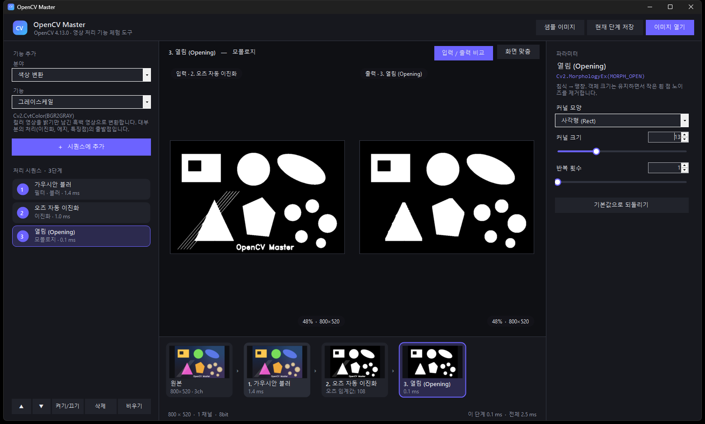

<p align="center">
  
</p>

<h1 align="center">OpenCV Master</h1>

<p align="center">A Windows desktop playground for trying out OpenCV before you write any code.</p>

<p align="center">Author: <b>Manggdy</b></p>

<p align="center"><b>English</b> | <a href="README.ko.md">한국어</a></p>



Load an image, chain processing steps into a sequence, tune each step's parameters with sliders, and watch every intermediate result update live.

## Download

Get `OpenCVMaster-Setup-<version>.exe` from the [Releases](https://github.com/mrkim0118/OpenCVMaster/releases/latest) page and run it. The .NET runtime is included, so nothing else needs to be installed.

## Features

- **88 OpenCV operations in 13 categories**: Color conversion, filters/blur, thresholding, morphology, edge detection, geometric transforms, histograms, feature detection (SIFT, ORB, AKAZE, BRISK, KAZE, FAST, MSER…), contours & shape analysis, segmentation (Watershed, GrabCut, K-means, SLIC), noise/restoration/frequency (DFT), object detection (QR, HOG people, template matching) and compositing with the original.
- **Parameter UI generated per operation**: Sliders + numeric boxes, drop-downs and check boxes appear depending on the selected function. Each step shows the OpenCV API it calls and a short explanation.
- **User-defined processing sequence**: Add, insert, reorder, enable/disable and delete steps freely.
- **Live preview of every stage**: A film strip shows each stage's result; the viewer compares a stage's input and output side by side with synchronized zoom/pan. Results recompute in the background as you drag.
- **Result info**: Otsu threshold values, contour/keypoint counts, decoded QR text, etc.
- **Wide image format support**: OpenCV decoders, then Windows Imaging Component (HEIC/HEIF, JXR, DDS, ICO…), then GDI+ (EMF/WMF). Non-ASCII (e.g. Korean) paths are supported. Drag & drop works.
- **Pixel inspector**: Hover the image to see coordinates and pixel values.

## Requirements

- Windows 10 1809 or later (x64)
- .NET 10 SDK
- OpenCvSharp4 4.13.0 (OpenCV 4.13.0, contrib modules included), restored automatically from NuGet

## Usage

1. Pick a **category** and **function** on the left, then press **+ Add to sequence** (it is inserted right after the selected stage).
2. Select a step to adjust its parameters on the right panel; the result updates immediately.
3. Use the film strip at the bottom to compare all stages; toggle **Input / Output compare** for a side-by-side view.
4. Mouse wheel = zoom, drag = pan, double-click = fit.

### Keyboard shortcuts

| Key | Action |
|---|---|
| `Ctrl+O` | Open image |
| `Ctrl+S` | Save current stage |
| `Delete` | Remove step |
| `Alt+↑` / `Alt+↓` | Reorder step |

## Build from Source

### Build

```powershell
dotnet run
```

Open a specific image at startup:

```powershell
dotnet run -- "path\to\image.jpg"
```

### Test

Run the headless self-test (every operation on color and gray input, plus file format round trips; writes `selftest.log`):

```powershell
dotnet run -- --selftest
```

### Release

Build a self-contained app (no .NET runtime needed on the target PC), then compile the installer with [Inno Setup 6](https://jrsoftware.org/isinfo.php). The setup file is written to `installer\Output\OpenCVMaster-Setup-<version>.exe`.

```powershell
dotnet publish -c Release -r win-x64 --self-contained true -o publish
```

```powershell
ISCC.exe installer\OpenCVMaster.iss
```

## Project Layout

| Path | Contents |
|---|---|
| `Core/Catalog.cs` | All operations, their parameters and implementations |
| `Core/Model.cs` | Parameter / operation / step model |
| `Core/Pipeline.cs` | Runs a sequence; failing steps pass their input through |
| `Core/ImageIO.cs` | Multi-decoder image loading and saving |
| `Core/SelfTest.cs` | Headless verification (`--selftest`) |
| `UI/` | Main window, theme and custom controls |
| `installer/OpenCVMaster.iss` | Inno Setup installer script |

## Libraries

- [OpenCvSharp4](https://github.com/shimat/opencvsharp) ([OpenCV](https://opencv.org/) 4.13.0)
